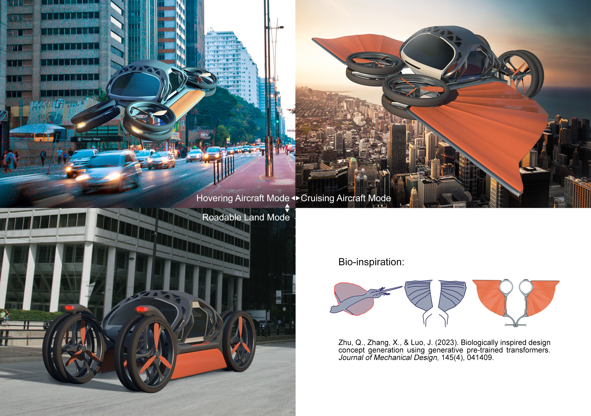
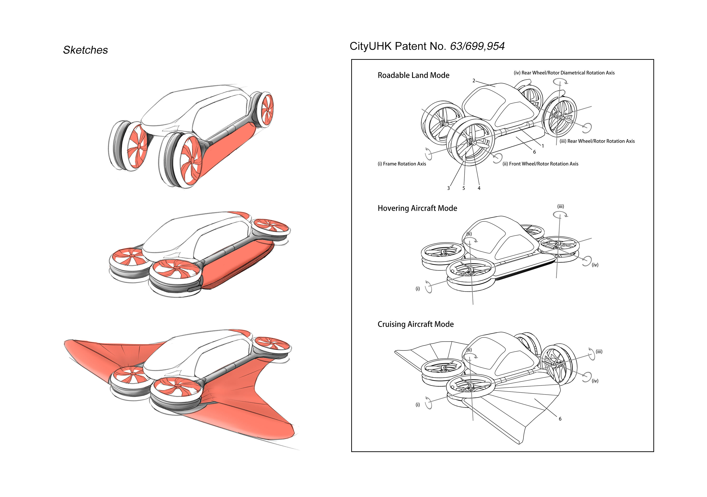

Current flying cars rely on separate heavy powertrains for ground and air travel, which increases **weight** and reduces **energy efficiency**. The bio-inspired solution uses a novel transformable structure that enables a **shared powertrain** across driving and flight modes while maintaining performance.

The wheels rotate to become rotors for hovering, and membrane wings unfold for efficient cruising, an idea drawn from the way rays and birds reshape their bodies for different kinds of movement. The concept grew out of my research on biologically inspired design concept generation with generative language models, and it has been filed as a patent application.
