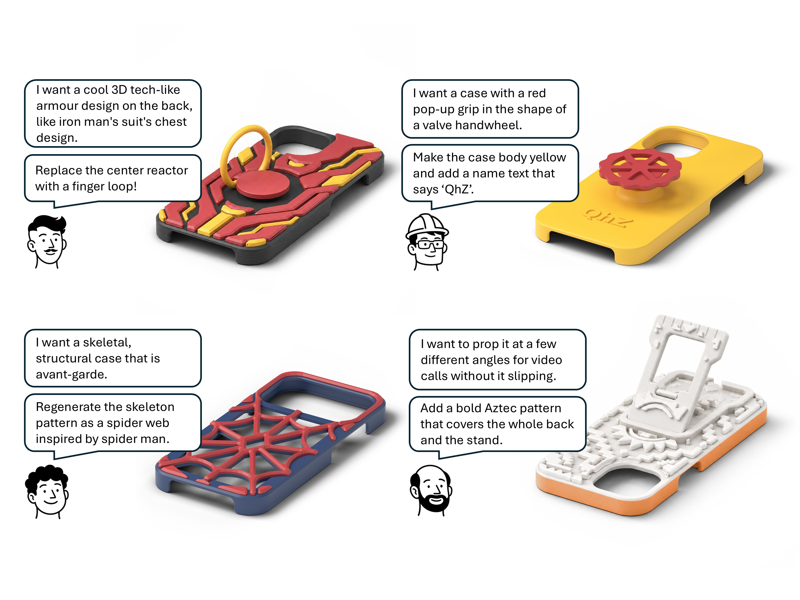
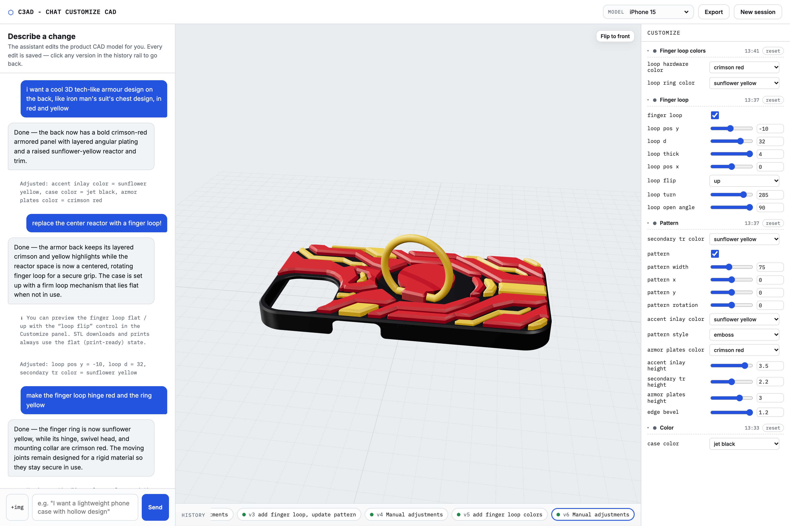

Consumer products are rarely a perfect fit for the person using them, yet the capabilities and tools for customizing products remains out of reach for most people. This project develops a web-based tool that lets non-experts design and personalize consumer products through conversation, sketches, and images. A design agent interprets what each person wants, both the needs they express and the needs it infers, and translates them into edits of a parametric CAD model.

To keep every change reliable and manufacturable, the agent works through structured geometry and fabrication skills and calls deterministic geometry tools rather than generating shapes freely. Every edit is saved as a version, parameters remain adjustable by hand, and the final model exports in a print-ready state. Connecting expressed and inferred needs to print-ready designs extends creative support from early ideation into later design stages, and aims to make personalized fabrication accessible to more people.

**Availability.** The code and the web interface will be made publicly accessible soon.
