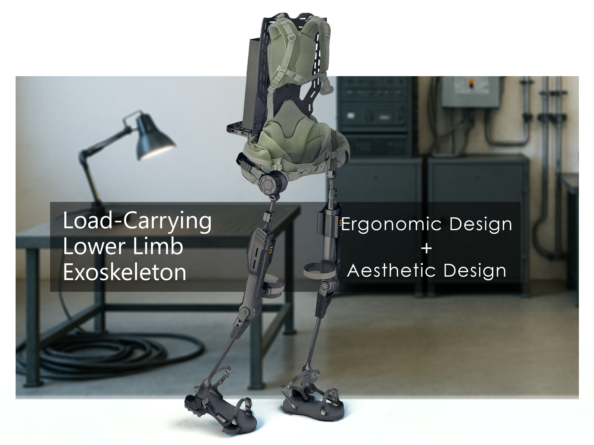
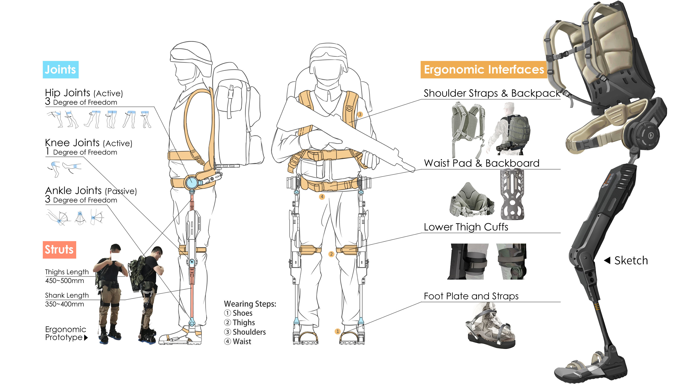
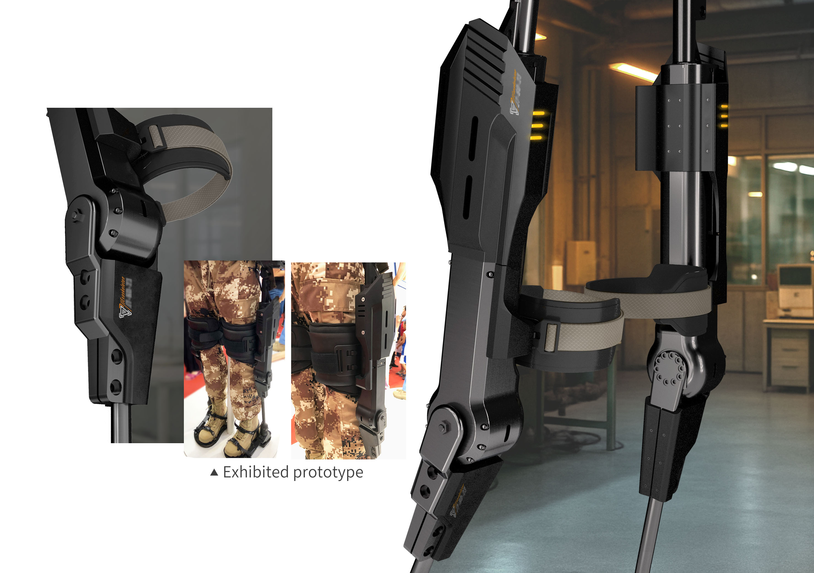

A load-carrying lower-limb exoskeleton for walking with heavy backpacks. The design work covered two threads: **ergonomic design**, so the device can be worn comfortably and walked in, and **aesthetic design**, so the product keeps a coherent visual identity through engineering iterations.

The ergonomic work involved active hip joints, active knee joints, and passive ankle joints, adjustable thigh and shank struts, and the body interfaces: shoulder straps and backpack, waist pad and backboard, lower thigh cuffs, and foot plates with straps. A wearable ergonomic prototype was built to test the wearing sequence and fit.

<!-- 

My master's thesis developed and implemented a methodology based on **Kansei Engineering** to systematically preserve aesthetic style and integrity amid the uncertainties of engineering iterations. It was applied and validated through this exoskeleton as a case study. -->

The product prototype was showcased at the World Robot Conference 2018 in Beijing.
