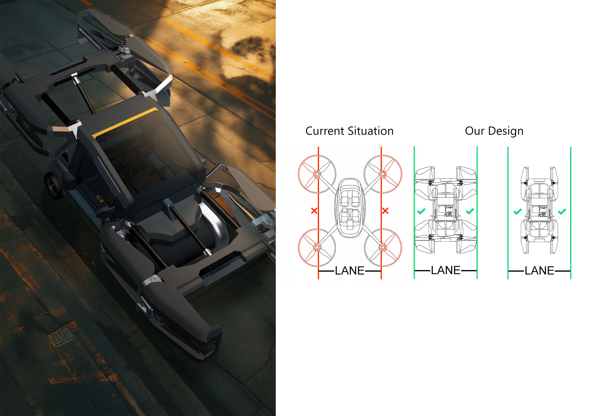
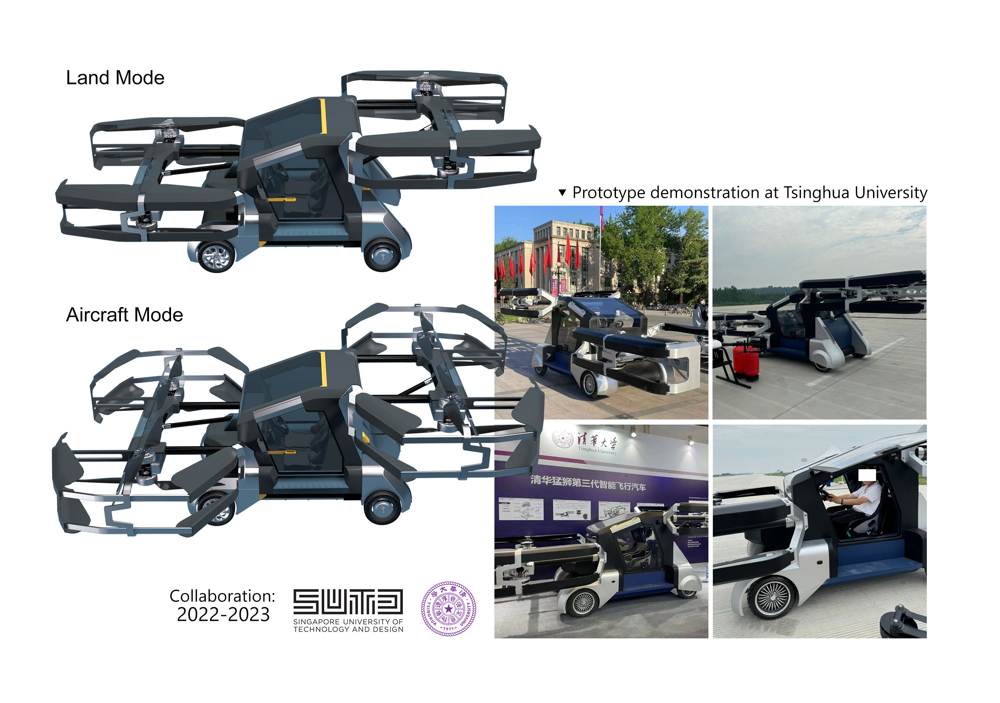

While several flying car concepts and models exist today, most utilize designs that are impractical for urban environments. Their width, including propellers, often exceeds lane dimensions, preventing normal road driving or takeoff. Our solution introduces a more **compact configuration** with **foldable propeller guards**. These guards protect the propellers while also retracting to reduce the vehicle's width during driving, ensuring a seamless experience comparable to conventional cars.

The vehicle switches between a land mode and an aircraft mode. The project combined research on generative-AI-inspired functional concept generation with human-centered design of the vehicle itself. A full-scale prototype was built and publicly showcased in 2024.
